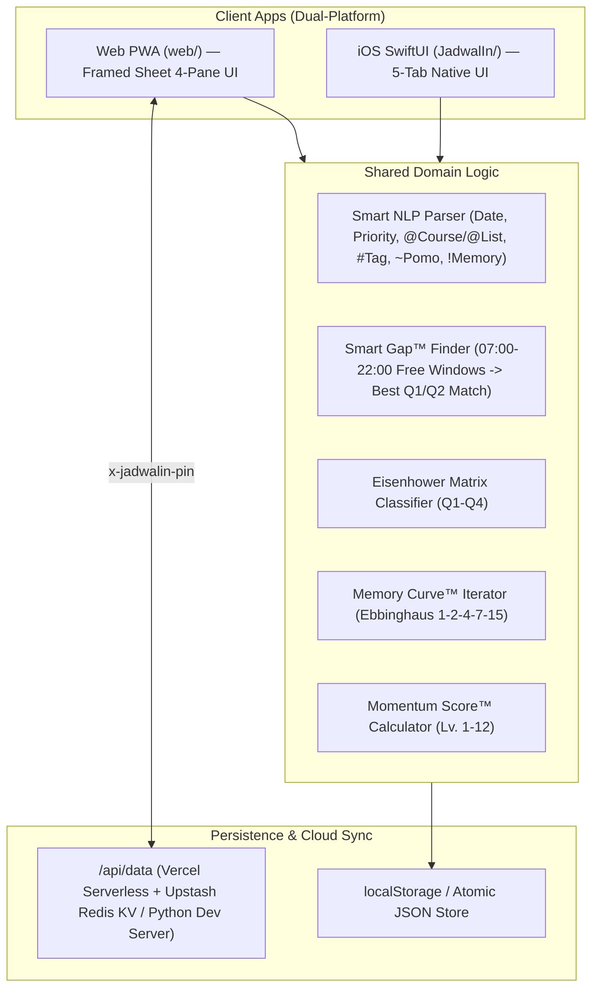

# Technical Design: luang.in Core Engine v2

## 1. Arsitektur Lintas Platform



## 2. Unified Store Schema v2

```json
{
  "schemaVersion": 2,
  "profile": {
    "name": "Pengguna luang.in",
    "role": "Teknik Informatika • Semester 3",
    "dailyFocusGoalMinutes": 120
  },
  "settings": {
    "theme": "classic",
    "pomoDuration": 25,
    "shortBreak": 5,
    "longBreak": 15,
    "notificationsEnabled": true
  },
  "lists": [
    { "id": "inbox", "name": "Inbox", "colorHex": "64748B" },
    { "id": "kuliah", "name": "Kuliah", "colorHex": "4772FA" },
    { "id": "organisasi", "name": "Organisasi", "colorHex": "D97706" },
    { "id": "pribadi", "name": "Pribadi", "colorHex": "247B50" }
  ],
  "courses": [],
  "tasks": [],
  "habits": [],
  "focusSessions": [],
  "countdowns": []
}
```

## 3. Penanganan Edge Cases & Migrasi
1. **Backward Compatibility v1 -> v2:** Jika store lama hanya memiliki array `assignments` dan belum memiliki `tasks`, mesin normalisasi otomatis mengonversi setiap `assignment` ke struktur `task` (memetakan `priority` string `"Tinggi"` -> `5`, `"Sedang"` -> `3`, `"Rendah"` -> `1`, dan menyinkronkan `isCompleted` dengan `status`).
2. **Validasi PIN Keamanan:** `api/data.js` dan `web/server.py` membandingkan `x-jadwalin-pin` secara tepat dengan `expectedPin` (`process.env.JADWALIN_PIN || "1234"`), tidak lagi mengizinkan `"1234"` saat PIN kustom telah diatur.
3. **Kejujuran Metrik (Anti-Slop Data Integrity):** Semua KPI di layar Insights & Dashboard (`Momentum Score`, `Focus Minutes`, `Completion Rate`, `Streaks`) dihitung secara langsung dari array data aktual pada saat render.
